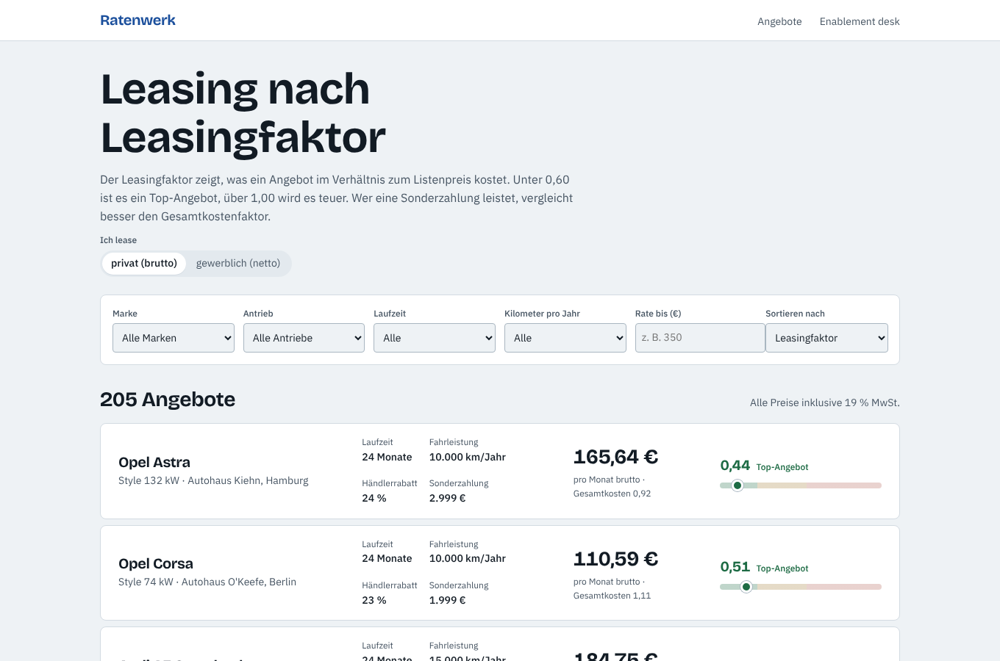
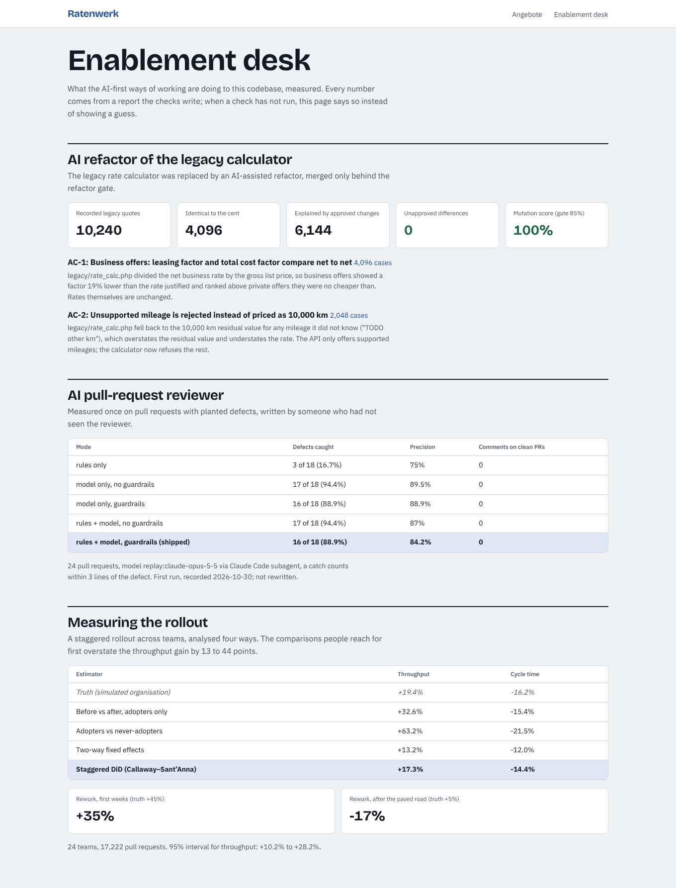

# leasing-ai-enablement

AI-first engineering on a real product codebase, measured. The product is a car-leasing
marketplace: a Laravel 13 API with search, quotes and dealer offers, and a Next.js 16 web app.
Around it sits the enablement work an AI-enabler role is hired to do. Each part produces numbers
that a team can check.



| Part | What it is | Measured |
| --- | --- | --- |
| **Guarded AI refactor** | The legacy procedural rate calculator was rewritten by an agent and merged only behind a golden master and a mutation-score gate | 10,240 recorded legacy quotes: 4,096 identical to the cent, 6,144 explained by two approved bug fixes, **0 unapproved**. Mutation score **100%** |
| **AI pull-request reviewer** | Team rules first, then a model (Claude or OpenAI, swappable), with guardrails: a comment must cite and quote a line the PR changed | Blind benchmark of 24 PRs: the model caught **17 of 18** planted defects with no comments on clean PRs. The shipped mode caught **16 of 18** |
| **Paved road for coding agents** | One AGENTS.md for Codex, Claude Code and Cursor; Claude Code hooks and skills; an MCP server with the codebase's own knowledge and guarded checks | Hooks block re-recording the golden master, pipe-to-shell installs and credential writes (tested) |
| **Measuring the rollout** | A staggered AI-tool rollout across 24 teams, analysed four ways | True gain +19%. Naive before/after **+33%**, adopters vs the rest **+63%**, staggered DiD **+17%** (interval +10% to +28%) |

## The product

```
apps/api   Laravel 13, PHP 8.3
  app/Domain/Leasing      RateCalculator (annuity with residual value), terms, quotes
  legacy/rate_calc.php    the 2017 calculator, kept as the reference
  GET  /api/offers        search: make, model, fuel, term, mileage, budget, sort, pages
  GET  /api/offers/makes  facets
  GET  /api/offers/{id}
  POST /api/offers/{id}/quote      your own term, mileage and down payment
  POST|PATCH|DELETE /api/dealer/offers   bearer token (sha256 stored), OfferPolicy ownership
apps/web   Next.js 16, React 19, Motion
  /                 offer search, filters in the URL, leasing factor scale
  /offers/{id}      quote calculator
  /enablement       the measured results below, read from the committed reports
```

Leasing domain as German buyers know it:
- **Leasingfaktor:** rate as a percentage of the list price.
- **Gesamtkostenfaktor:** the same, including the down payment and one-off costs.
- Private offers gross, business offers net, compared net to net.
- Dealer discounts lower what is financed, while the residual value stays on the list price.

Glossary: [docs/glossary.md](docs/glossary.md).

Engineering details:
- **Search caching.** Results are cached under a key built from every filter plus a catalogue
  version, so any write invalidates them on any cache store. Responses carry strong ETags (304s),
  and a test proves there is no N+1 query.
- **Telemetry.** Every request writes one JSON log line with request id, route, status, duration,
  query count and time, and cache hit. The same data goes into `Server-Timing` headers. No tokens
  or bodies are logged (tested).
- **Rates are computed, never accepted.** The API refuses `monthly_rate_cents` from a dealer.

## Guarded AI refactor

[Playbook](docs/playbooks/ai-refactoring.md).

**What it found:**
- **AC-1:** business offers compared a net rate to a gross price and looked 19% cheaper than they
  were.
- **AC-2:** an unsupported mileage was silently priced as 10,000 km.

Both are approved changes with a reason and an owner.

**What mutation testing found that the golden master missed:** an approval that allowed "any
difference" in two fields hid a wrong VAT conversion. Approvals now name the exact value they expect.



## AI reviewer

[Playbook](docs/playbooks/ai-review.md). `packages/reviewer`:
- a diff parser;
- 15 team rules from AGENTS.md (money as floats, rates from clients, writes without the policy
  check, SQL from strings, removed eager loading, destructive migrations, tokens in logs, cache keys
  missing a filter, swallowed errors, `any`, unsafe HTML, credentials, …);
- Anthropic and OpenAI providers with forced JSON;
- guardrails;
- a GitHub Action that posts a COMMENT review, never an approval;
- a local CLI.

The benchmark PRs were written by an agent that never saw the reviewer. The model answers were
recorded once and are replayed, so the result is reproducible. **The guardrails did not pay on this
set:** they removed one true finding and no noise. The playbook says so and says what would change
that.

## Paved road

- [AGENTS.md](AGENTS.md): conventions and agent rules, read by every tool. Codex reads it natively;
  [CLAUDE.md](CLAUDE.md) points to it.
- `.claude/settings.json` hooks:
  - [guard.mjs](.claude/hooks/guard.mjs) blocks edits to the pricing reference, the pricing config,
    the quality gates, legacy code and env files; it also blocks credentials, `curl | sh`,
    `--record`, force pushes and `migrate:fresh`;
  - [after-edit.mjs](.claude/hooks/after-edit.mjs) lints PHP at once and reminds the agent of the
    gates after a domain edit.
- Skills: `add-search-filter`, `characterise-before-refactor`, `review-ai-pr`.
- [MCP server](packages/mcp) (`.mcp.json`):
  - `leasing_glossary` (German and English)
  - `team_conventions` (by topic)
  - `api_routes` (read from `routes/api.php`)
  - `run_check`: an allow-list of checks, arguments validated, no shell, timeouts
- A real example of why: the Laravel skeleton's own agent file told agents to pipe an installer
  from the internet into a shell. It is kept in
  [docs/playbooks/examples](docs/playbooks/examples/skeleton-agent-bootstrap.md.txt), and the hook
  blocks exactly that.

## Measuring the rollout

[Playbook](docs/playbooks/measuring-ai-adoption.md) ·
[results](reports/adoption/RESULTS.md).

The simulated organisation has the problems real ones have:
- faster teams volunteer first;
- the whole organisation drifts faster;
- holidays hit everyone at once;
- rework rises until the paved road is in;
- later cohorts gain more.

The analysis only sees pull requests and rollout dates.

## Run it

```bash
cd apps/api && composer install && cp .env.example .env && php artisan key:generate
php artisan migrate --seed && php artisan serve          # API on :8000
php artisan test --parallel                              # 75 Pest tests
php artisan leasing:golden-master --verify && composer mutate && composer stan
cd ../.. && npm ci && npm test                           # reviewer, MCP + hooks, web
cd apps/web && npm run build && npx playwright test      # 15 end-to-end tests on the real stack
cd ../../experiments/adoption && pip install -e '.[test]' && pytest -q && python -m adoption.evaluate
```

## Tests

| Suite | |
| --- | --- |
| API (Pest): domain, golden master, search, caching, ETags, N+1, quotes, dealer auth and ownership, validation, telemetry | 75 |
| Mutation testing of the domain code | 100% |
| Reviewer (diff, rules, guardrails, providers, GitHub client, scoring) | 37 |
| MCP server and Claude Code hooks | 14 |
| Web components (loading, error, retry, empty states, URL filters, desk) | 11 |
| End to end with axe (search, filters, business net, empty, API failure and retry, skeletons, quote calculator, 404, desk, keyboard, phone) | 15 |
| Adoption experiment (truth isolation, recovery, interval coverage, phases) | 12 |

## Limits

- The marketplace data, the dealers and the engineering organisation are simulated. The rate maths
  and the leasing conventions are real; the offers are not.
- The benchmark has 18 defects. One more catch moves recall by 5.6 points.
- The model answers were recorded from Claude running as a Claude Code subagent, not through the
  API, and the defects were planted by the same model family.
- Larastan and the GitHub Action run in CI; the PHAR could not be run in the environment the code
  was written in.
